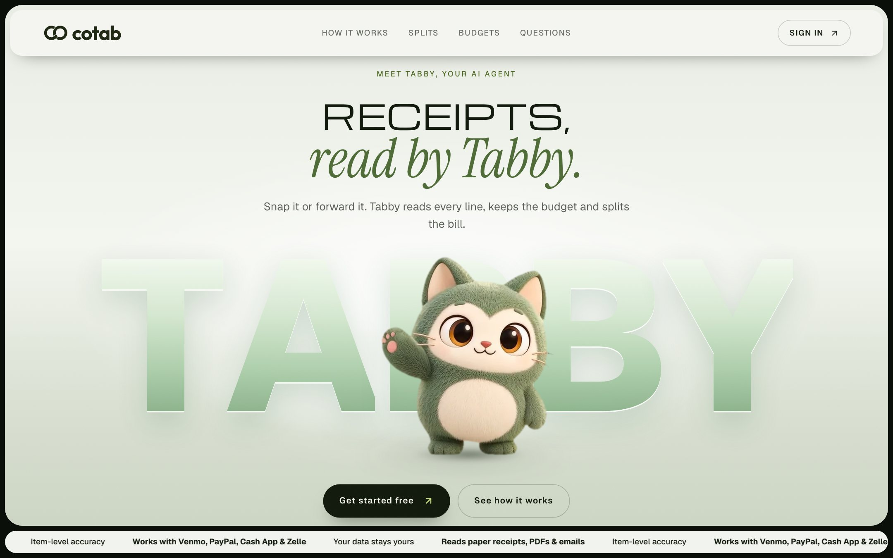

<div align="center">

# Hi, I'm Srihari Chepuri 👋

<a href="https://github.com/sriharichepuri21">
  
</a>

[](https://sriharichepuri21.github.io)
[](https://www.linkedin.com/in/sri-hari-417b191a1)
[](mailto:sh.chepuri21@gmail.com)

</div>

---

## 👨‍💻 About Me

```yaml
role:        Software Engineer @ LiveRamp
experience:  3+ years — LiveRamp, Zebra Technologies, University of North Texas
focus:       distributed systems, data platforms, event-driven microservices
education:   MS Business Analytics, University of North Texas
location:    Seattle, WA
principle:   every project ships with measured results — and its limits
```

---

## 💼 Experience Highlights

| | What I built | Result |
|---|---|---|
| **LiveRamp** | Java/Python control- and data-plane services on AWS | **10+ TB/day**, 500M+ daily requests, multi-tenant |
| | Parquet ingestion pipeline redesign | **90 → 700 configs/day** (7×) |
| | Pipeline observability and tuning | P95 latency **1.2 s → 340 ms** |
| | Temporal + Airflow migration workflows | **50+ TiB** migrated, +20% throughput |
| **Zebra Technologies** | Versioned data-access service (Java, Thrift, MySQL, OAuth2) | Consistent data access for downstream teams |
| | On-call for JVM services behind PTT Pro | **50+** critical incidents resolved, 10,000+ daily users |

---

## 🚀 Featured Projects

<a href="https://github.com/sriharichepuri21/stateverdict">
  <picture>
    <source media="(prefers-color-scheme: dark)" srcset="https://raw.githubusercontent.com/sriharichepuri21/stateverdict/main/docs/assets/hero-dark.svg">
    
  </picture>
</a>

<a href="https://cotab.center">
  
</a>

| Project | What it does | Proof | Built with |
|---|---|---|---|
| **[StateVerdict](https://github.com/sriharichepuri21/stateverdict)**<br>[▶ live demo](https://sriharichepuri21.github.io/stateverdict/) | Makes Kafka messages arrive twice, late or out of turn **on purpose**, then checks the databases, not the status codes | 🐞 Found a **money-creation bug** in an open-source Kafka app<br>✅ **0 false alarms** in 510 valid scenarios<br>🎯 **6/6** planted bugs caught<br>⚡ **~35 ns** overhead per message | Java 21, Spring Boot, Kafka, PostgreSQL, Testcontainers |
| **[Kairo](https://github.com/sriharichepuri21/kairo-marketplace-intelligence)** | A marketplace plus the data platform behind it: dbt bronze/silver/gold models, churn ML, data-quality monitoring | 📦 **16M+** generated records<br>🧪 dbt **153 passing, 0 errors**<br>💰 **$0** reconciliation variance | Next.js, FastAPI, PostgreSQL, dbt, DuckDB, scikit-learn, Streamlit |
| **[Cotab](https://github.com/sriharichepuri21/Cotab)**<br>[▶ try it](https://cotab.center) | An AI-powered money app. **Tabby**, its AI agent, reads every line of a receipt (photo, PDF or forwarded email), keeps item-level budgets, splits bills to the cent with pro-rata tax and tracks who owes whom. Ask in plain words; every change waits for your approval | 🚀 **Live** at cotab.center<br>🧪 **826** backend · **185** unit · **50** browser tests<br>🔒 17 typed tools; AI-written SQL is read-only, parsed, allow-listed and user-scoped<br>✅ Every AI change needs your yes | Python, FastAPI, Gemini, PostgreSQL, Next.js, TypeScript |

---

## 🛠️ Tech Stack

**Languages**<br>


**Backend & Messaging**<br>


**Data**<br>


**Cloud & Delivery**<br>


---

## 📊 GitHub Stats

<div align="center">


</div>

---

## 🤝 Connect

<div align="center">

Open to conversations about **backend, distributed systems and data infrastructure** roles.<br>
The fastest way to reach me is [LinkedIn](https://www.linkedin.com/in/sri-hari-417b191a1) or [email](mailto:sh.chepuri21@gmail.com).

</div>
